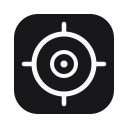
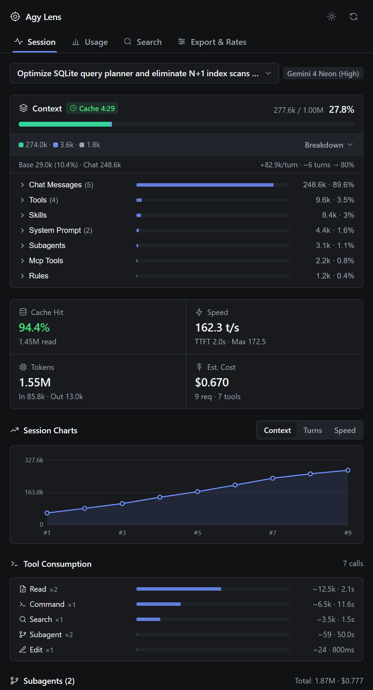
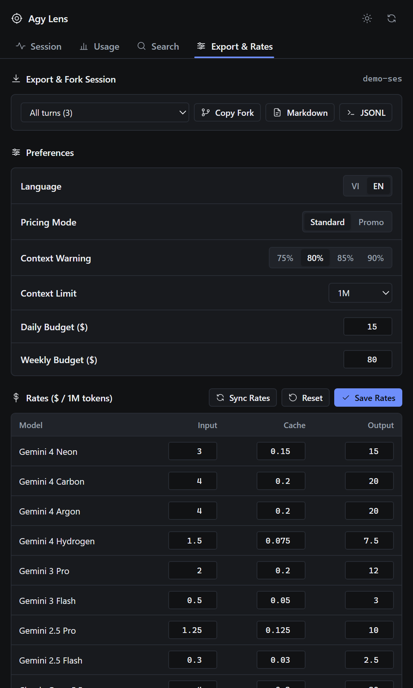
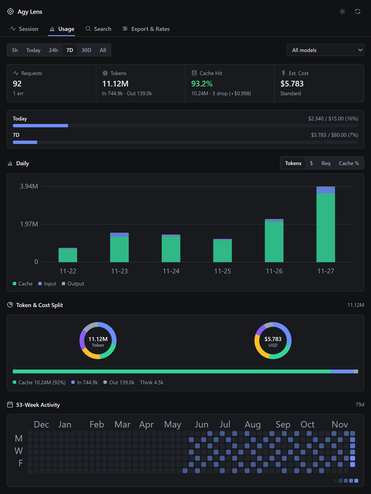
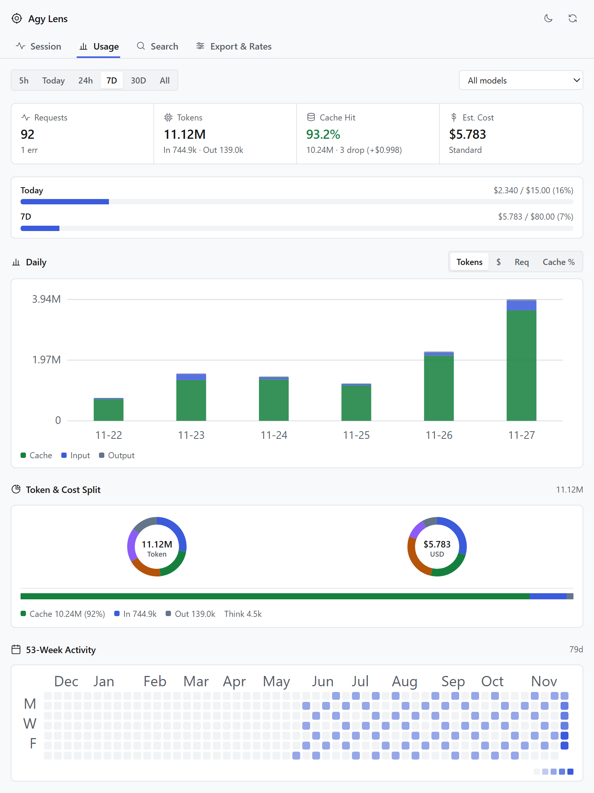

<div align="center">
  
  <h1>Agy Lens</h1>
  <p><strong>Zero-Intrusion, Read-Only Telemetry &amp; Token Analytics Plugin for Antigravity 2.0</strong></p>
  <p>
    
    
    
    
    
  </p>
</div>

**Agy Lens** is a native Antigravity 2.0 Aux Pane plugin built exclusively on Antigravity's official `sidecar_sdk`. It gives you deep visibility into context window consumption, prompt cache efficiency, generation speed, token burn attribution, multi-day usage &amp; cost analytics, full-text transcript search, and one-click session export/forking—**without ever touching Antigravity's application source code, binaries, shortcuts, or renderer process.**

---

## Security &amp; Zero-Intrusion Architecture

Unlike extensions that inject scripts into Electron or rewrite client files, **Agy Lens is strictly isolated and read-only by design**:

| Security Boundary | Agy Lens Behavior |
| --- | --- |
| **Antigravity Source &amp; Binaries** | **Never touched.** Does not patch, hook, or modify any Antigravity installation file, `.asar` archive, or OS launcher shortcut. |
| **Chrome DevTools Protocol (CDP)** | **Zero CDP.** Does not enable `--remote-debugging-port`, attach to the renderer, or inject DOM scripts into the main workspace. |
| **Database &amp; Transcript Access** | **100% Read-Only.** Opens local `conversations/*.db` via Node's built-in `node:sqlite` (`{ readOnly: true }`, `PRAGMA query_only=ON`) and reads `transcript.jsonl` without write locks. |
| **Accounts &amp; Credentials** | **Zero access.** Never reads OS keyrings, OAuth tokens, cookies, or Google account credentials. |
| **Network Traffic** | **Offline by default.** Zero background telemetry or automatic outbound requests. Official pricing sync runs **only** when you explicitly click **Sync Rates**. |
| **Runtime Dependencies** | **Zero external npm packages.** Ships as a compact bundled sidecar (~142 KB total) running on Antigravity's built-in Node runtime, authenticated via `X-Sidecar-Token` on `127.0.0.1`. |

---

## Screenshots

<table>
  <tr>
    <th width="50%">Session Telemetry &amp; Context Drill-Down (Dark)</th>
    <th width="50%">Export, Fork &amp; Budget / Pricing Rates (Dark)</th>
  </tr>
  <tr>
    <td align="center" valign="top">
      
      <p>Live 1M context meter, Base Overhead vs. Chat split, burn-rate forecast, expandable per-category drill-down, session trend charts, tool consumption, and clickable subagent inspection.</p>
    </td>
    <td align="center" valign="top">
      
      <p>Export Markdown/JSONL or copy a clean Fork handoff prompt up to any turn, set daily/weekly USD budgets, adjust context limits, and edit or manually sync model pricing.</p>
    </td>
  </tr>
  <tr>
    <th>Usage Dashboard, Dual Donuts &amp; 53-Week Heatmap (Dark)</th>
    <th>Usage Dashboard &amp; Light Theme Sync (Light)</th>
  </tr>
  <tr>
    <td align="center" valign="top">
      
      <p>Filter by <code>5h</code>, <code>Today</code>, <code>24h</code>, <code>7D</code>, <code>30D</code>, or <code>All</code>; track daily/weekly budget progress, stacked daily token bars, dual Token/Cost donuts, 53-week activity heatmap, and per-model speeds.</p>
    </td>
    <td align="center" valign="top">
      
      <p>Automatically syncs with Antigravity's Light and Dark themes via official <code>preload.js</code> theme tokens, including Top Sessions ranking and Request Events with Cache Drop waste calculation.</p>
    </td>
  </tr>
</table>

---

## Key Features

### 1. Session Telemetry &amp; Token Burn Attribution (`Session`)
- **Context Window &amp; Drill-Down Breakdown:** Displays exact context fill (default `1M` tokens, configurable to `256K` / `512K` / `1M` / `2M` / `Auto (DB)`), segmented by `Cache Read / Input / Output`, with pinned-open breakdown categories sorted heaviest-first. Click any category (`Chat Messages`, `Tools`, `System Prompt`, `Skills`, `MCP Tools`) to expand its top token-consuming child items.
- **Static Context Tax &amp; Burn-Rate Forecast:** Separates fixed per-request overhead (`Base`: System Prompt, Tools, Skills, MCP, Plugins, Rules) from conversation history (`Chat`), calculates average growth (`+Xk/turn`), and estimates remaining turns until your warning threshold.
- **Live Prompt Cache TTL:** Real-time 5-minute countdown badge showing whether the session's server-side prompt cache is still warm or expired.
- **Session Charts:** Switch between **Context Growth** (area chart with warning threshold line), **Per-Turn Tokens** (stacked bars), and **Output Speed** (`tok/s` with average baseline).
- **Tool Consumption Breakdown:** Aggregates `Command`, `Read`, `Edit`, `Search`, and `Subagent` calls with counts, errors, wall-clock duration, and estimated output token contribution.
- **Subagent Inspection &amp; Combined Totals:** View combined `Session + Subagents` token/cost totals and click any subagent row to inspect its own telemetry, with a one-click **Parent** back button.

### 2. Usage, Cost &amp; Cache Analytics (`Usage`)
- **Flexible Windows &amp; Multi-Source Support:** Filter across `5h`, `Today`, `24h`, `7D`, `30D`, and `All`, combining Antigravity Desktop and `antigravity-cli` (when present).
- **Visualizations:** Stacked daily token chart (`Cache / Input / Output`), daily Cost/Requests bars, daily `Cache %` trend line, dual **Token &amp; Cost** model donuts, and a **53-Week Activity Heatmap**.
- **Model Performance Table:** Compares requests, tokens, cache hit %, estimated cost, and **Avg / Peak `tok/s`** (with buffered tail-flush correction).
- **Top Sessions &amp; Budget Tracking:** Ranks your most expensive conversations (click to open) and tracks daily/weekly spend against customizable USD budget bars.
- **Request Events &amp; Cache Waste Estimator:** Filter by keyword, conversation, `Errors`, or `Cache Drop` (excluding cold starts and compactions). Quantifies the extra USD wasted by unexpected cache drops (`+$X.XX`) and offers one-click error copying.

### 3. Full-Text Transcript Search (`Search`)
- Instant local search across past `transcript.jsonl` logs scoped by **All**, **Text**, **Code**, or **Command** (`/` keyboard shortcut), with highlighted snippets, one-click copy, and direct jump via `window.sidecar.ui.toggleConversation`.

### 4. Export, Read-Only Fork &amp; Offline Rates (`Export &amp; Rates`)
- **Export &amp; Fork:** Export any conversation (full or up to Turn `#N`) as **Markdown** or **JSONL**, or click **Copy Fork** to copy a structured handoff prompt for branching into a fresh conversation without mutating Antigravity's database.
- **Editable Pricing &amp; Manual Sync:** Works fully offline with an editable per-model USD/1M rate table (`Standard` / `Promo`), auto-discovers newly used local models, and includes an explicit manual **Sync Rates** button.
- **Bilingual UI:** Switch cleanly between English (`EN`) and Vietnamese (`VI`).

---

## Installation

> **Requirements:** Antigravity 2.0 installed (no `npm install`, no admin privileges, and no client modifications required).

### Windows (PowerShell)
```powershell
git clone https://github.com/monghai978/agy-lens.git
cd agy-lens
powershell -NoProfile -ExecutionPolicy Bypass -File .\install.ps1
```

### macOS / Linux / WSL2
```sh
git clone https://github.com/monghai978/agy-lens.git
cd agy-lens
sh ./install.sh
```

After installing:
1. Open **Antigravity → Customizations → Plugins** and ensure **Agy Lens** is enabled (the installer never edits `config.json`).
2. Open **Agy Lens** from the right Aux Pane (restart Antigravity once if the sidecar was not previously loaded).

### Uninstall
```powershell
# Windows (append -KeepSettings to preserve your preferences & rates)
powershell -NoProfile -ExecutionPolicy Bypass -File .\uninstall.ps1
```
```sh
# macOS / Linux (append --keep-settings to preserve your preferences & rates)
sh ./uninstall.sh
```

---

## Data Storage

- **Plugin directory:** `~/.gemini/config/plugins/agy-lens/`
- **Local settings &amp; derived cache:** `~/.gemini/antigravity/plugin_data/agy-lens/` (`settings.json`, `usage-archive-v1.json`, optional `pricing-sync.json`)
- **Session exports:** `~/Downloads/agy-lens/` (or `~/.gemini/antigravity/plugin_data/agy-lens/exports/` if `~/Downloads` is unavailable)
- **Antigravity files modified:** **None.**
